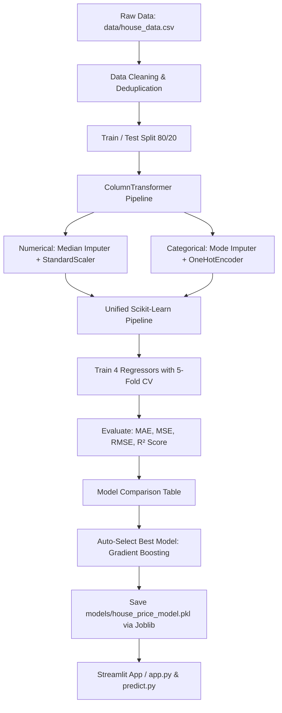

# 🏡 House Price Prediction - Machine Learning System

A complete, production-ready **House Price Prediction** Machine Learning application built using **Python**, **Scikit-Learn**, **Pandas**, **Seaborn**, and **Streamlit**.

This application allows real estate analysts, buyers, and sellers to accurately estimate property market value based on physical attributes (living area, bedrooms, bathrooms, floors, parking spaces), geographic location, year built, and property architectural style.

---

## 🌟 Key Features

- **End-to-End ML Pipeline**: Unified `Pipeline` and `ColumnTransformer` integrating numerical missing imputation, categorical encoding, and feature scaling without any data leakage.
- **Model Comparison & Automatic Selection**: Evaluates 4 regression models:
  - Linear Regression
  - Decision Tree Regressor
  - Random Forest Regressor
  - Gradient Boosting Regressor (Best performing model: **R² = 0.9836**, **RMSE = $56,453.42**)
- **5-Fold Cross Validation**: Validates generalization performance across folds.
- **Exploratory Data Analysis (EDA)**: Matplotlib and Seaborn visualizations for distributions, correlations, and feature impacts.
- **Interactive Streamlit Web Dashboard**:
  - Live valuation estimates with confidence intervals (±6% market variance).
  - Price per square foot calculation.
  - One-click presets (e.g. *Modern Downtown Condo*, *Luxury Waterfront Villa*, *Suburban Family Home*).
  - Embedded model comparison table & interactive EDA charts.
- **Joblib Model Persistence**: Saves the complete preprocessing and model pipeline to `models/house_price_model.pkl`.

---

## 📁 Project Structure

```
house_price_prediction/
│
├── data/
│   └── house_data.csv             # Primary housing dataset
│
├── models/
│   ├── house_price_model.pkl      # Serialized scikit-learn pipeline (preprocessor + model)
│   ├── model_comparison.csv       # Evaluation metric table comparing all models
│   └── model_metadata.json        # Best model parameters and metrics
│
├── notebooks/
│   └── house_price_analysis.ipynb # Jupyter notebook with end-to-end data science walkthrough
│
├── reports/
│   └── figures/                   # High-resolution saved EDA visualizations
│       ├── 01_price_distribution.png
│       ├── 02_area_vs_price.png
│       ├── 03_bedrooms_vs_price.png
│       ├── 04_bathrooms_vs_price.png
│       ├── 05_correlation_heatmap.png
│       └── 06_location_vs_price.png
│
├── src/
│   ├── __init__.py                # Package initializer
│   ├── generate_dataset.py        # Realistic housing data generator
│   ├── data_preprocessing.py      # Data cleaning, imputer & ColumnTransformer pipeline
│   ├── eda.py                     # Visualization functions for exploratory analysis
│   ├── train_model.py             # Model training, 5-fold CV, comparison & serialization
│   └── predict.py                 # Predictor class with input validation & inference
│
├── app.py                         # Streamlit web application
├── requirements.txt               # Project dependencies
├── README.md                      # Documentation & user guide
└── .gitignore                     # Git ignore file
```

---

## ⚙️ Installation & Setup (Windows)

Follow these steps to set up the project locally on Windows:

### 1. Clone or Open the Project Directory
Open **Command Prompt** or **PowerShell** in the project folder:
```powershell
cd "c:\Users\Kamran Ashraf\Desktop\ai_corvit\projects\house price prediction"
```

### 2. Create and Activate a Virtual Environment
```powershell
python -m venv .venv
.venv\Scripts\activate
```

### 3. Install Dependencies
```powershell
pip install -r requirements.txt
```

---

## 🚀 Running the Project

### 1. Launch the Streamlit Web Application
```powershell
streamlit run app.py
```
After running this command, your default web browser will open at:
```
http://localhost:8501
```

### 2. Retrain Models & Compare Performance (Optional)
To retrain models from scratch and regenerate `models/house_price_model.pkl`:
```powershell
python src/train_model.py
```

### 3. Generate EDA Visualizations
To produce and save the 6 exploratory charts into `reports/figures/`:
```powershell
python src/eda.py
```

### 4. Run CLI Prediction Test
To test inference on a sample house directly from the command line:
```powershell
python src/predict.py
```

### 5. Open Jupyter Notebook Analysis
```powershell
jupyter notebook notebooks/house_price_analysis.ipynb
```

---

## 📊 Machine Learning Workflow



### 1. Feature Specifications

| Feature Name | Type | Description |
|---|---|---|
| `Area` | Continuous (Numeric) | Total living space in square feet (e.g. 500 – 6,000 sq ft) |
| `Bedrooms` | Discrete (Numeric) | Total bedroom count (1 – 6) |
| `Bathrooms` | Discrete (Numeric) | Total bathroom count (1 – 5) |
| `Floors` | Discrete (Numeric) | Above-ground stories (1 – 4) |
| `Parking` | Discrete (Numeric) | Covered / garage parking capacity (0 – 4) |
| `Location` | Categorical (Nominal) | `Downtown`, `Suburban`, `Urban`, `Rural`, `Waterfront`, `Uptown` |
| `YearBuilt` | Discrete (Numeric) | Construction completion year (1960 – 2024) |
| `PropertyType`| Categorical (Nominal) | `Single Family`, `Townhouse`, `Apartment`, `Condo`, `Villa` |
| **`Price`** (Target) | Continuous (Numeric) | House valuation in USD ($) |

### 2. Preprocessing & Leakage Prevention
- **Numerical Features** (`Area`, `Bedrooms`, `Bathrooms`, `Floors`, `Parking`, `YearBuilt`):
  - Missing values imputed using `SimpleImputer(strategy='median')`.
  - Normalized with `StandardScaler()`.
- **Categorical Features** (`Location`, `PropertyType`):
  - Imputed using `SimpleImputer(strategy='most_frequent')`.
  - Encoded with `OneHotEncoder(drop='first', handle_unknown='ignore')`.
- All transformers are embedded into an `sklearn.pipeline.Pipeline`, ensuring that statistical parameters (mean, standard deviation, category mappings) are **fit only on training data**, preventing data leakage to the test or inference data.

---

## 🏆 Model Evaluation & Comparison Results

The models were evaluated on an unseen 20% test split (600 properties) with 5-fold cross-validation:

| Model | CV R² (Mean) | CV R² (Std) | Test MAE ($) | Test RMSE ($) | Test R² Score |
|---|---|---|---|---|---|
| **Gradient Boosting Regressor** | **0.9859** | **±0.0017** | **$39,019.47** | **$56,453.42** | **0.9836** |
| Random Forest Regressor | 0.9825 | ±0.0020 | $43,765.99 | $61,053.11 | 0.9808 |
| Decision Tree Regressor | 0.9692 | ±0.0011 | $58,103.17 | $80,128.08 | 0.9670 |
| Linear Regression | 0.9454 | ±0.0030 | $74,418.31 | $105,897.36 | 0.9423 |

### Metric Formulas
- **MAE** (Mean Absolute Error): $\frac{1}{n} \sum |y_i - \hat{y}_i|$
- **MSE** (Mean Squared Error): $\frac{1}{n} \sum (y_i - \hat{y}_i)^2$
- **RMSE** (Root Mean Squared Error): $\sqrt{\frac{1}{n} \sum (y_i - \hat{y}_i)^2}$
- **R² Score** (Coefficient of Determination): $1 - \frac{\sum (y_i - \hat{y}_i)^2}{\sum (y_i - \bar{y})^2}$

---

## 🖥️ Streamlit Web App Interface

1. **Prediction Tab**:
   - Sliders and selectors for Area, Bedrooms, Bathrooms, Floors, Parking, Location, Year Built, and Property Type.
   - Click **🔮 Predict House Price** to receive:
     - **`Estimated House Price: $X,XXX,XXX.XX`**
     - Estimated Market Range (±6% confidence interval)
     - Price per Square Foot ($/sq ft)
2. **Model Comparison Tab**:
   - Live comparison table and horizontal bar charts contrasting R² and RMSE across models.
3. **Market Insights & EDA Tab**:
   - High-definition seaborn visual plots: Price distribution, Area vs. Price, Rooms vs. Price, Correlation Heatmap, Location vs. Average Price.

---

## 🛡️ Robustness & Error Handling

- **Missing Input Handling**: Handled seamlessly by imputation layers in the model pipeline.
- **Unseen Categories**: Handled by `OneHotEncoder(handle_unknown='ignore')` without throwing runtime errors.
- **Non-Negative Output Guarantee**: Predicted prices are constrained to positive real values.
- **Dynamic File Resolution**: All file paths are constructed relative to `__file__`, allowing the project to run from any directory.

---

## 📜 License
This project is open-source and available under the [MIT License](LICENSE).
